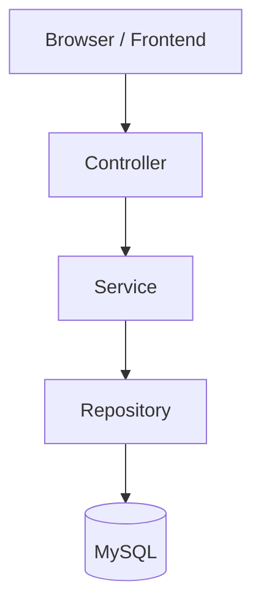

# 🛒 E-Commerce Web Application

A full-stack e-commerce application: a Spring Boot REST API with JWT authentication and role-based access (`USER` / `ADMIN`), 
backed by MySQL, with a Bootstrap browser frontend. Customers manage a cart and place orders; admins manage products, product images and order statuses.

The project covers authentication, authorization, product management, shopping cart operations, order processing, image upload,
validation, pagination and centralized exception handling.


---

## Key Features

### Customers

- Registration and login with email and 10-digit phone number validation
- BCrypt password hashing and JWT-based authentication
- Shopping cart management
- Place orders from the cart; view order history and order details
- Cancel eligible orders (see [Order Lifecycle](#order-lifecycle))

### Products

- Product CRUD operations
- Search by product name
- Paginated product listing
- Product image upload, with uploaded images served by the application

### Orders

- Orders created from the current cart
- Server-side order total calculation
- Order items store the purchase quantity and product price
- Order status management

### Admin

- Admin account seeded at startup from environment variables
- Role-restricted product and product image management
- Paginated view of all orders and order status updates
- Dashboard totals for products, orders and pending orders

---

## Tech Stack

| Layer | Technology |
|---|---|
| Backend | Java 17, Spring Boot 4.1.1, Spring MVC, Spring Data JPA, Hibernate |
| Security | Spring Security, JWT (JJWT 0.13.0), BCrypt |
| Validation | Jakarta Bean Validation / Spring Boot Validation |
| Database | MySQL |
| Frontend | HTML5, CSS3, JavaScript, Bootstrap 5.3.3 |
| Build | Maven |

---

## Architecture



The backend is organized into a layered structure:

- **Controller** – handles HTTP requests and REST endpoints
- **Service** – contains application and business logic
- **Repository** – performs database operations through Spring Data JPA
- **Entity** – models persistent domain data
- **DTO** – carries API request and response data
- **Exception** – custom exceptions and centralized error handling
- **Security** – JWT authentication and security configuration

Pagination is implemented with Spring Data `Pageable` for product listings and the admin order listing. Open EntityManager in View is explicitly disabled with `spring.jpa.open-in-view=false`.

---

## Security Design

- JWT authentication is implemented with a custom `JwtAuthenticationFilter`.
- HTTP session creation is disabled with `SessionCreationPolicy.STATELESS`.
- Passwords are encoded with BCrypt before persistence.
- The application models two roles: `USER` and `ADMIN`.
- Admin operations are protected with method-level authorization using `@PreAuthorize("hasRole('ADMIN')")`.
- Other non-public API requests require authentication.
- Database credentials, JWT configuration and admin credentials are provided through environment variables rather than hard-coded in source files.
- The seeded admin password is BCrypt-encoded before it is saved.

---

## Configuration

The application uses environment variables for sensitive and environment-specific configuration.

| Environment variable | Required | Default | Purpose |
|---|---|---|---|
| `DB_USERNAME` | Yes | – | MySQL username |
| `DB_PASSWORD` | Yes | – | MySQL password |
| `JWT_SECRET` | Yes | – | JWT signing key |
| `ADMIN_EMAIL` | Yes | – | Seeded admin email |
| `ADMIN_PASSWORD` | Yes | – | Seeded admin password |
| `ADMIN_PHONE` | Yes | – | Seeded admin phone number |
| `DB_URL` | No | `jdbc:mysql://localhost:3306/ecommerce_db` | JDBC connection URL |
| `DDL_AUTO` | No | `update` | Hibernate schema mode |
| `SHOW_SQL` | No | `false` | Enable SQL logging |
| `UPLOAD_DIR` | No | `${user.dir}/uploads/products` | Product image storage directory |

A variable-name template is provided in `.env.example`. It is documentation only: the application reads the environment variables themselves and does not require a committed `.env` file.

---

## Getting Started

### Prerequisites

- JDK 17 or later
- MySQL
- Git

Maven does not need to be installed globally because the repository includes the Maven Wrapper.

### 1. Clone the repository

```bash
git clone https://github.com/Himanshu200315/ecommerce-web-application.git
cd ecommerce-web-application
```

### 2. Create the database

```sql
CREATE DATABASE ecommerce_db;
```

### 3. Configure environment variables

Set the required variables in the same terminal (or IDE run configuration) you will use to start the application. `JWT_SECRET` should be a long random value of at least 32 bytes, for example the output of `openssl rand -base64 32`.

**Windows PowerShell**

```powershell
$env:DB_USERNAME="root"
$env:DB_PASSWORD="your-password"
$env:JWT_SECRET="your-long-random-secret"
$env:ADMIN_EMAIL="admin@example.com"
$env:ADMIN_PASSWORD="your-admin-password"
$env:ADMIN_PHONE="9999999999"
```

**Linux / macOS**

```bash
export DB_USERNAME=root
export DB_PASSWORD='your-password'
export JWT_SECRET='your-long-random-secret'
export ADMIN_EMAIL='admin@example.com'
export ADMIN_PASSWORD='your-admin-password'
export ADMIN_PHONE='9999999999'
```

You can also set the same variables in an IntelliJ IDEA Run Configuration.

### 4. Run the application

**Windows**

```powershell
.\mvnw.cmd spring-boot:run
```

**Linux / macOS**

```bash
./mvnw spring-boot:run
```

The application starts on `http://localhost:8080`. The frontend is served from `src/main/resources/static`, with `index.html` mapped as the welcome page.

Log in with the `ADMIN_EMAIL` and `ADMIN_PASSWORD` you configured to access admin features.

---

## API Overview

| Method | Path | Access | Purpose |
|---|---|---|---|
| POST | `/users/register` | Public | Register a new user |
| POST | `/users/login` | Public | Authenticate and receive a JWT |
| GET | `/products` | Public | Get paginated products |
| GET | `/products/search?name={name}` | Public | Search products by name |
| POST | `/products` | ADMIN | Create a product |
| PUT | `/products/{id}` | ADMIN | Update a product |
| DELETE | `/products/{id}` | ADMIN | Delete a product |
| POST | `/products/{id}/image` | ADMIN | Upload a product image |
| GET | `/cart/items` | Authenticated | Get current cart items |
| POST | `/cart/items` | Authenticated | Add a product to the cart |
| PUT | `/cart/items/{id}` | Authenticated | Update cart-item quantity |
| DELETE | `/cart/items/{id}` | Authenticated | Remove a cart item |
| POST | `/orders` | Authenticated | Place an order from the current cart |
| GET | `/orders` | Authenticated | Get the current user's orders |
| GET | `/orders/{orderId}` | Authenticated | Get an order belonging to the current user |
| PUT | `/orders/{orderId}/cancel` | Authenticated | Cancel an eligible order |
| PUT | `/orders/{orderId}/status` | ADMIN | Update order status |
| GET | `/orders/admin` | ADMIN | Get paginated orders for administration |
| GET | `/orders/admin/pending-count` | ADMIN | Get the number of pending orders |

Authenticated requests send the JWT in the `Authorization: Bearer <token>` header.

---

## Order Lifecycle

Order statuses: `PENDING`, `CONFIRMED`, `SHIPPED`, `DELIVERED`, `CANCELLED`.

The service layer implements these transitions:

```text
PENDING   → CONFIRMED / CANCELLED
CONFIRMED → SHIPPED / CANCELLED
SHIPPED   → DELIVERED
```

`DELIVERED` and `CANCELLED` orders cannot be moved to another status. Customer cancellation is supported for `PENDING` and `CONFIRMED` orders.

---

## File Uploads

Product images are uploaded through the product image endpoint and stored under the configured upload directory. Images are served through the `/uploads/products/**` resource path.

The default upload location is `${user.dir}/uploads/products`, which is relative to the directory the application is launched from unless `UPLOAD_DIR` is set.

---

## Exception Handling

A global `@RestControllerAdvice` provides centralized exception handling, including validation errors, duplicate user data, missing resources, invalid passwords and invalid order status changes.

---

## Testing

The repository currently contains the Spring Boot application context test:

```text
src/test/java/com/himanshu/ecommerce/EcommerceProjectApplicationTests.java
```

This test starts the full application context, so it needs a reachable MySQL database and the required environment variables. For the same reason, `mvnw package` also needs them; add `-DskipTests` to build without a database.

```powershell
.\mvnw.cmd test
```

Feature-level automated tests are planned (see [Roadmap](#roadmap)).

---

## Troubleshooting

| Problem | Likely cause |
|---|---|
| Startup fails because a placeholder such as `DB_USERNAME` is unresolved | The required environment variable is not set in the environment used to start the application |
| MySQL reports access denied | The configured database username or password is incorrect |
| The database cannot be found | `ecommerce_db` has not been created, or `DB_URL` points to a different database |
| JWT creation reports a weak key | `JWT_SECRET` is too short for the configured HMAC signing algorithm |

---

## Roadmap

- [ ] Isolated automated tests that do not depend on a local MySQL configuration
- [ ] Broader unit and integration test coverage
- [ ] Database migrations instead of `ddl-auto=update`
- [ ] OpenAPI / Swagger documentation
- [ ] Docker containerization
- [ ] Persistent or object storage for product images (local disk is ephemeral on many hosting platforms)
- [ ] Refresh tokens and payment integration

---

## Background

Built to practice Spring Boot backend development on a complete application. It started with core CRUD functionality and grew to cover authentication, authorization, relational data, file uploads, pagination, validation and order workflows, with a browser frontend integrated against the API.

---

## Author
**Himanshu Atotiya** · [GitHub](https://github.com/Himanshu200315)